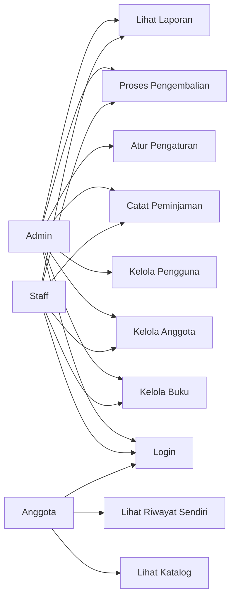

# BAHAN PRESENTASI - PERPUSTAKAAN SMK BPPI

Versi: 3.0 (Laravel 10 + SQLite, tampilan kustom SMK BPPI)
Durasi: 15 menit presentasi + 5 menit demo
Seluruh isi dokumen ini sesuai dengan kode yang benar-benar berjalan.

---

# BAGIAN 1 - SLIDE PRESENTASI

## Slide 1 - Judul

**Perpustakaan SMK BPPI**

Aplikasi web untuk mengelola perpustakaan: data buku, data anggota, peminjaman,
pengembalian, dan denda keterlambatan.

- Nama / NIM / Kelas / Dosen
- Tanggal presentasi

Kalimat pembuka:

> "Selamat pagi. Saya mempresentasikan Sistem Informasi Perpustakaan yang
> dibangun dengan framework Laravel dan database SQLite. Aplikasi ini sudah
> berjalan penuh dan sudah diuji otomatis."

## Slide 2 - Latar Belakang

Masalah pada perpustakaan konvensional:

1. Pencatatan peminjaman masih manual di buku tulis, mudah hilang.
2. Sulit mengetahui buku sedang dipinjam siapa.
3. Keterlambatan tidak terkontrol, denda sering terlewat.
4. Tidak ada laporan peminjaman dan anggota teraktif.

Solusi: aplikasi web dengan tiga tingkat pengguna (Admin, Staff, Anggota),
validasi otomatis, dan laporan real-time.

## Slide 3 - Tujuan

1. Mempercepat proses peminjaman dan pengembalian.
2. Menghitung denda keterlambatan secara otomatis.
3. Memisahkan hak akses Admin, Staff, dan Anggota.
4. Menyediakan laporan kapan pun: buku terlaris dan anggota teraktif.
5. Mudah dipindahkan ke komputer lain tanpa instalasi database server.

## Slide 4 - Fitur Utama

| Modul | Fitur |
|---|---|
| Autentikasi | Login berbasis peran, password ter-hash |
| Data Buku | CRUD, kode otomatis, pencarian, filter kategori, stok |
| Data Anggota | CRUD, kode otomatis, status aktif atau nonaktif |
| Peminjaman | Pencatatan cepat, validasi stok, kuota, keterlambatan |
| Pengembalian | Hitung denda otomatis, tandai lunas, cetak bukti |
| Laporan | Rekap transaksi, buku terlaris, anggota teraktif, terlambat |
| Manajemen User | Khusus Admin |
| Pengaturan | Batas pinjam, masa pinjam, tarif denda |

## Slide 5 - Teknologi yang Digunakan

| Lapisan | Teknologi | Versi / Keterangan |
|---|---|---|
| Bahasa server | PHP | 8.1 (minimal 8.1) |
| Framework | Laravel | 10.50 (MVC) |
| Bahasa database | SQL | SQLite 3 (file database) |
| Bahasa antarmuka | PHP Blade | Template bawaan Laravel |
| Tampilan | CSS3 + JavaScript | Bersamaan dengan proyek, tanpa CDN |
| Format data | JSON | Konfigurasi `.env` |
| Pengujian | PHPUnit | 10 pengujian otomatis |
| Server lokal | `php artisan serve` | PHP built-in server |

Tidak ada Node.js, Vite, atau CDN yang wajib dipakai, sehingga aplikasi tetap
jalan di komputer yang tidak terhubung internet.

## Slide 6 - Desain Antarmuka (UI/UX)

Tampilan dibuat khusus, tanpa framework pihak ketiga, agar ringan dan tetap
jalan tanpa internet.

| Unsur | Spesifikasi |
|---|---|
| Latar | Krem hangat `#FBF7EC` |
| Warna utama | Hijau tua `#22494A` |
| Aksen | Oranye bata `#D8862B` |
| Bentuk | Tombol pil, kartu sudut 20-28px, bayangan lembut |
| Gerak | Kartu muncul bertahap, tombol terangkat saat hover |

Fitur tampilan:

1. **Beranda publik** untuk pengunjung sebelum login (hero, fitur, 3 tingkat pengguna).
2. **Sidebar dinamis** sesuai hak akses pengguna.
3. **Kepala halaman** dengan ikon, judul, deskripsi, dan tombol aksi.
4. **Kartu statistik** berwarna dengan ikon.
5. **Katalog kartu buku** dengan punggung buku berwarna-warni.
6. **Ilustrasi rak buku** dibuat murni dengan CSS, tanpa file gambar.
7. **Status berbentuk pil** dan tabel dengan baris menyala saat kursor diarahkan.

Berkas tampilan: `public/css/app.css`, `resources/views/components/`,
`resources/views/partials/`.

Kalimat untuk dodge pertanyaan:

> "Antarmuka tidak memakai Bootstrap atau Tailwind. Satu design system ditulis
> dalam satu file CSS, komponen Blade dibuat agar tampilan konsisten dan mudah
> diubah."

---

## Slide 7 - Arsitektur Aplikasi

```
Browser (Chrome/Edge/Firefox)
        |  http://localhost:8000
        v
Laravel 10  ->  routes/web.php  ->  RoleMiddleware  ->  Controller
                                                                |
                                          Model (Eloquent) <----+
                                                                |
                                                        SQLite (database.sqlite)
                                                                |
                                                     Blade View (tampilan)
```

Alur satu permintaan:

1. Browser mengirim alamat URL.
2. `routes/web.php` menentukan halaman mana yang diakses.
3. `RoleMiddleware` memeriksa apakah pengguna punya hak akses.
4. Controller mengambil data dari Model.
5. Model/query membaca tabel SQLite.
6. Controller mengirim data ke View (Blade).
7. Blade mengirim HTML ke browser.

## Slide 8 - Database

**Jenis database:** SQLite
**Lokasi berkas database:**

```
C:\Users\Gio\Desktop\arulll\perpustakaan\database\database.sqlite
```

Konfigurasi di `.env`:

```
DB_CONNECTION=sqlite
```

**Tabel yang dibuat:**

| Tabel | Isi |
|---|---|
| `users` | Akun admin, staff, anggota |
| `buku` | Data buku dan jumlah stok |
| `anggota` | Data anggota perpustakaan |
| `peminjaman` | Transaksi peminjaman dan pengembalian |
| `pengaturan` | Batas pinjam, masa pinjam, tarif denda |

Semua tabel dibuat oleh 1 file migration:
`database/migrations/2024_01_01_000100_create_perpustakaan_tables.php`

**Relasi:**

```
anggota (1) -----< peminjaman >----- (1) buku
peminjaman >----- (1) users (kasir yang melayani)
anggota (1) ----- (1) users (akun anggota)
```

**Cara membuka database secara manual:**

1. Buka folder `perpustakaan/database`.
2. Klik kanan `database.sqlite`.
3. Buka dengan aplikasi DB Browser for SQLite atau SQLiteStudio.
4. Tabel database terlihat dalam bentuk kolom dan baris.

**Cara memindahkan data ke komputer lain:**

Copy 1 file `database.sqlite`, tempel ke folder `database` komputer tujuan.

## Slide 9 - Tiga Tingkat Pengguna

| Fitur | Admin | Staff | Anggota |
|---|---|---|---|
| Dashboard | YA | YA | YA (miliknya) |
| Data Buku | penuh | tambah/ubah | tidak |
| Data Anggota | penuh | tambah/ubah | tidak |
| Peminjaman | YA | YA | tidak |
| Pengembalian | YA | YA | tidak |
| Laporan | YA | YA | tidak |
| Manajemen User | YA | tidak | tidak |
| Pengaturan | YA | tidak | tidak |

Penegakan hak akses berada di server, pada `routes/web.php` baris 24 dan 29:

```php
Route::middleware('role:anggota')->group(...)        // menu anggota
Route::middleware('role:admin,staff')->group(...)    // menu petugas
Route::middleware('role:admin')->group(...)          // menu administrator
```

Middleware-nya: `app/Http/Middleware/RoleMiddleware.php`, didaftarkan sebagai
alias `role` di `app/Providers/AppServiceProvider.php`.

Kalau anggotaDpaksa membuka `/buku`, sistem membalas **403 Forbidden**.

## Slide 10 - Alur Peminjaman dan Pengembalian

**Peminjaman:**

1. Petugas memilih anggota dan buku.
2. Tanggal pinjam diisi otomatis hari ini.
3. Tanggal batas kembali dihitung dari pengaturan (default 7 hari).
4. Nomor transaksi dibuat otomatis, contoh `PMJ-0001`.
5. Simpan, lalu buku tersedia berkurang.

**Validasi yang berjalan otomatis** (`app/Http/Controllers/PeminjamanController.php`
baris 57-69):

| Kondisi | Pesan |
|---|---|
| Stok habis | Stok buku tidak tersedia. |
| Anggota nonaktif | Anggota berstatus tidak aktif... |
| Ada buku terlambat | Selesaikan pengembalian terlebih dahulu. |
| Kuota penuh | Batas maksimal 3 buku. |

**Pengembalian:**

1. Petugas klik tombol Kembalikan.
2. Sistem menghitung keterlambatan dan estimasi denda.
3. Tanggal dikembalikan disimpan.
4. Denda dihitung otomatis.
5. Tombol Tandai Lunas menandai pembayaran denda.
6. Tombol Cetak menghasilkan bukti transaksi siap cetak.

Rumus denda (`app/Http/Controllers/PengembalianController.php` baris 52-53):

```
Hari terlambat = Tanggal kembali - Tanggal batas kembali  (minimal 0)
Denda          = Hari terlambat x Tarif denda per hari
```

Contoh: batas 22 Oktober, kembali 24 Oktober, tarif Rp 1.000, denda Rp 2.000.

## Slide 11 - Pengujian

Pengujian otomatis tersedia di `tests/Feature/PerpustakaanTest.php`.

Jalankan dengan:

```bash
php artisan test
```

Hasil: **10 pengujian lulus, 24 assertion.**

| Pengujian | Yang dibuktikan |
|---|---|
| Halaman login dapat diakses | Halaman login tampil normal |
| Admin dapat login | Login benar dan diarahkan ke dashboard |
| Password salah ditolak | Autentikasi menolak |
| Anggota tidak bisa buka /buku | Hak akses ditegakkan (403) |
| Staff tidak bisa buka /pengguna | Hak akses ditegakkan (403) |
| Peminjaman tercatat | Stok tersedia berkurang 1 |
| Batas pinjam terlampaui | Peminjaman ditolak |
| Pengembalian menghitung denda | 3 hari x Rp 1.000 = Rp 3.000 |
| Laporan dapat diakses admin | Halaman laporan tampil |

## Slide 12 - Kesimpulan

1. Sistem sudah berjalan penuh untuk 3 peran pengguna.
2. Proses peminjaman dan pengembalian cepat, validasi otomatis, denda terhitung
   tepat.
3. Laporan tersedia kapan pun: rekap transaksi, buku terlaris, anggota
   teraktif, daftar terlambat.
4. Menggunakan SQLite sehingga mudah dibawa ke komputer lain.
5. Kode tertata rapi per bagian dan dilengkapi pengujian otomatis.

*Saran pengembangan:* versi online dengan MySQL,notifikasi email pengingat
jatuh tempo, dan QR Code untuk peminjaman.

---

# BAGIAN 2 - SKRIP DEMO (5 MENIT)

Siapkan sebelum demo: terminal sudah berjalan `php artisan serve`, browser
sudah terbuka di `http://localhost:8000`.

## Menit 1 - Login dan Dashboard

1. Buka `http://localhost:8000`, tampilkan form login.
2. Login sebagai **admin / admin123**.
3. Tunjukkan 6 kartu statistik, 2 grafik batang, tabel transaksi terbaru.
4. Sebutkan: "Dashboard menampilkan data real-time dari database."

## Menit 2 - Kelola Buku dan Anggota

1. Menu **Data Buku** -> cari "Clean" -> tampilkan hasil pencarian.
2. Tambah buku baru, jelaskan kode dibuat otomatis `BK-0009`.
3. Menu **Data Anggota** -> tampilkan jumlah peminjaman, terlambat, total denda
   per anggota.
4. Ubah status satu anggota menjadi nonaktif.

## Menit 3 - Peminjaman (demo validasi)

1. Menu **Peminjaman** -> tombol **+ Catat Peminjaman**.
2. Tunjukkan notice: masa pinjam 7 hari, batas 3 buku, denda Rp 1.000/hari.
3. Catat peminjaman untuk anggota dengan status nonaktif.
4. Tunjukkan pesan penolakan: "Anggota berstatus tidak aktif..."
5. Catat peminjaman untuk anggota yang sudah 3 buku.
6. Tunjukkan pesan: "Anggota sudah memiliki 3 buku. Batas maksimal 3 buku."
7. Catat peminjaman yang berhasil, tampilkan nomor `PMJ-0006`.

## Menit 4 - Pengembalian dan Denda

1. Menu **Pengembalian**.
2. Tunjukkan tabel buku yang terlambat beserta estimasi denda.
3. Klik **Kembalikan** -> tampilkan ringkasan dan perkiraan denda.
4. Simpan pengembalian -> transaksi berpindah ke riwayat, status **Selesai**.
5. Klik **Tandai Lunas** untuk denda.
6. Klik **Cetak** -> tampilkan bukti transaksi, tekan Ctrl+P.

## Menit 5 - Laporan, User, Pengaturan, dan Bukti Keamanan

1. Menu **Laporan** -> tampilkan rekap, buku terlaris, anggota teraktif,
   daftar terlambat. Klik **Cetak Laporan**.
2. Login sebagai **anggota1 / anggota123** -> tunjukkan menu berbeda
   (Dashboard, Katalog, Riwayat saja).
3. Coba buka `http://localhost:8000/buku` -> tampilkan **403 Forbidden**.
4. Login kembali sebagai admin -> menu **Manajemen User** dan **Pengaturan**.
5. Ubah tarif denda menjadi Rp 2.000, tunjukkan efeknya pada perhitungan
   perhitungan denda. (Kembalikan lagi ke Rp 1.000 setelah demo.)

Kalimat penutup:

> "Semua data disimpan pada satu file database SQLite di folder
> `perpustakaan/database/database.sqlite`, jadi sistem ini cukup disalin satu
> folder untuk dijalankan di komputer lain."

---

# BAGIAN 3 - RINGKASAN TEKNOLOGI

## 3.1 Daftar Teknologi

| No | Teknologi | Peran | Alasan memilih |
|---|---|---|---|
| 1 | PHP 8.1 | Bahasa pemrograman server | Gratis, banyak dokumentasi, mudah dipasang |
| 2 | Laravel 10.50 | Framework MVC | Otomatis keamanan, validasi, dan rapi |
| 3 | SQLite 3 | Database | Cukup untuk 1 perpustakaan, database berupa 1 file, tanpa install |
| 4 | PHP Blade | Template tampilan | Terintegrasi dengan Laravel, cepat |
| 5 | CSS3 | Gaya tampilan | Tampilan rapi responsif tanpa framework tambahan |
| 6 | JavaScript | Interaksi | Konfirmasi sebelum menghapus data |
| 7 | PHPUnit | Pengujian otomatis | Bawaan Laravel, 10 pengujian |
| 8 | `.env` + file `.sqlite` | Konfigurasi dan database | Portabel ke komputer lain |

## 3.2 Komponen Laravel yang Dipakai

| Komponen | Lokasi | Fungsi |
|---|---|---|
| Route | `routes/web.php` | Daftar alamat URL + batas hak akses |
| Middleware | `app/Http/Middleware/RoleMiddleware.php` | Pemeriksa peran pengguna |
| Controller | `app/Http/Controllers/*` | Logika setiap halaman |
| Model | `app/Models/*` | Struktur tabel dan kalkulasi (terlambat, denda) |
| Migration | `database/migrations/*` | Pembuat tabel database |
| Seeder | `database/seeders/DatabaseSeeder.php` | Data contoh awal |
| View | `resources/views/*` | Tampilan Blade |
| Test | `tests/Feature/PerpustakaanTest.php` | Pengujian otomatis |

## 3.3 Pengamanan yang Digunakan

1. Password di-hash bcrypt (`app/Models/User.php` baris 26).
2. Token CSRF pada setiap form (`@csrf`).
3. Cookie sesi terenkripsi.
4. Pembatasan menu dan URL per peran (middleware `role`).
5. Pesan validasi berbahasa Indonesia (`lang/id/validation.php`).

---

# BAGIAN 4 - PENJELASAN KODE PER BAGIAN

| Bagian | File Utama | Isi |
|---|---|---|
| Login | `app/Http/Controllers/AuthController.php` | Cek username + password, buat sesi |
| Pembatas hak akses | `app/Http/Middleware/RoleMiddleware.php` | Tolak akses jika peran tidak sesuai |
| Dashboard | `app/Http/Controllers/DashboardController.php` | Hitung statistik dan grafik |
| Buku | `app/Http/Controllers/BukuController.php` | CRUD buku, pencarian, filter |
| Anggota | `app/Http/Controllers/AnggotaController.php` | CRUD anggota, status aktif |
| Peminjaman | `app/Http/Controllers/PeminjamanController.php` | Validasi dan pencatatan peminjaman |
| Pengembalian | `app/Http/Controllers/PengembalianController.php` | Hitung denda, simpan pengembalian |
| Laporan | `app/Http/Controllers/LaporanController.php` | Rekap, buku terlaris, anggota teraktif |
| User | `app/Http/Controllers/UserController.php` | Manajemen akun pengguna |
| Pengaturan | `app/Http/Controllers/PengaturanController.php` | Batas pinjam, masa pinjam, tarif denda |
| Kode otomatis | `app/Support/Kode.php` | Membuat kode BK-0001, ANG-0001, PMJ-0001 |
| Perhitungan | `app/Models/Peminjaman.php` | Hitung hari terlambat dan denda |

---

# BAGIAN 5 - CARA MEMBUKA FILE (RINGKAS)

Jalankan di dalam folder `perpustakaan`:

```bash
composer install
php artisan key:generate
php artisan migrate --seed
php artisan serve
```

Lalu buka browser:

```
http://localhost:8000
```

Akun demo:

| Peran | Username | Kata Sandi |
|---|---|---|
| Admin | admin | admin123 |
| Staff | staff | staff123 |
| Anggota | anggota1 | anggota123 |

Memindahkan ke komputer lain: copy seluruh folder `perpustakaan` (bukan hanya
`database.sqlite`), lalu jalankan `php artisan serve` di komputer tersebut.
Tanpa perlu MySQL, XAMPP, atau internet.

Detail lengkap ada di `TATACARA-BUKA.md`.

---

# BAGIAN 6 - PERTANYAAN YANG MUNGKIN MUNCUL

| Pertanyaan | Jawaban singkat |
|---|---|
| Kenapa tidak pakai MySQL? | Supaya mudah dipindahkan. SQLite cukup untuk 1 perpustakaan dan databasenya hanya 1 file. |
| Di mana database disimpan? | `perpustakaan/database/database.sqlite`. |
| Bagaimana cara pinjam mengembalikan? | Menu Peminjaman, pilih anggota dan buku, klik Simpan. Pengembalian lewat menu Pengembalian, sistem menghitung denda otomatis. |
| Bagaimana pembatasan hak akses bekerja? | Middleware `role` memeriksa peran pengguna di server, anggota yang membuka `/buku` mendapat 403. |
| Bagaimana kalau pw lupa? | Admin dapat mengatur ulang lewat menu Manajemen User. |
| Bagaimana cara backup data? | Copy file `database/database.sqlite`. |
| Bisakah dipakai di banyak komputer? | Saat ini untuk 1 komputer (lokal). Untuk banyak komputer, ganti ke MySQL dan jalankan di server. |
| Bagaimana kalau tabel rusak? | Jalankan `php artisan migrate:fresh --seed` untuk membuat ulang. |
| Apakah sudah diuji? | Ya, 10 pengujian otomatis lulus (`php artisan test`). |
| Kenapa kode tidak perlu React atau Node.js? | Tampilan memakai Blade dan CSS biasa, cukup untuk kebutuhan sistem ini. |

---

# BAGIAN 7 - CHECKLIST SEBELUM PRESENTASI

- [ ] `php artisan test` lulus semua
- [ ] `php artisan migrate:fresh --seed` sudah dijalankan
- [ ] Server berjalan di `http://localhost:8000`
- [ ] Login ketiga akun berhasil
- [ ] Data contoh sudah ada (8 buku, 3 anggota, 5 transaksi)
- [ ] Browser sudah di-set zoom 100%
- [ ] ERD dan use case sudah digambar di slide (Bagian 8)
- [ ] File `PRD-PERPUSTAKAAN.md` dan `TATACARA-BUKA.md` siap sebagai lampiran

---

# BAGIAN 8 - PERSIAPAN SIDANG

Bagian ini disiapkan untuk menjawab pertanyaan dosen atau penguji yang lebih
teknis.

---

## 8.1 Diagram ERD (Entity Relationship Diagram)

Gambar ERD ini di slide. Isinya:

```
+------------------+                   +------------------+
|      users       |                   |     anggota      |
+------------------+                   +------------------+
| PK id            |<---- 1 : 1 ------>| PK id            |
|    username (U)  |                   |    kode (U)      |
|    email (U)     |                   |    nama          |
|    password      |                   |    nik           |
|    role          |                   |    gender        |
|    telepon       |                   |    telepon       |
|    status        |                   |    email         |
|    anggota_id FK |                   |    alamat        |
+------------------+                   |    tanggal_daftar|
                                       |    status        |
                                       +------------------+
                                                |
                                                | 1
                                                v  banyak
                                      +----------------------+
                                      |     peminjaman       |
                                      +----------------------+
                                      | PK id                |
                                      |    kode (U)          |
                                      |    tanggal_pinjam    |
                                      |    tanggal_batas     |
                                      |    tanggal_kembali   |
                                      |    judul             |
                                      |    status            |
                                      |    hari_terlambat    |
                                      |    denda             |
                                      |    denda_lunas       |
                                      | FK anggota_id        |
                                      | FK buku_id           |
                                      | FK kasir_id --------> users
                                      +----------------------+
                                                ^
                                                | 1
                                      +------------------+
                                      |      buku        |
                                      +------------------+
                                      | PK id            |
                                      |    kode (U)      |
                                      |    isbn          |
                                      |    judul         |
                                      |    penulis       |
                                      |    penerbit      |
                                      |    tahun         |
                                      |    kategori      |
                                      |    stok          |
                                      |    lokasi        |
                                      +------------------+

                                      +------------------+
                                      |    pengaturan    |
                                      +------------------+
                                      | PK id            |
                                      |    batas_pinjam  |
                                      |    masa_pinjam   |
                                      |    tarif_denda   |
                                      +------------------+
```

Keterangan: PK = Primary Key, FK = Foreign Key, U = Unique (tidak boleh kembar).

Tabel `pengaturan` tidak berhubungan dengan tabel lain karena isinya konfigurasi
sistem untuk seluruh aplikasi.

### Cardinality (jumlah hubungan)

| Hubungan | Cardinality | Penjelasan |
|---|---|---|
| anggota ke peminjaman | 1 : banyak | Satu anggota bisa memiliki banyak transaksi |
| buku ke peminjaman | 1 : banyak | Satu judul buku bisa dipinjam berkali-kali |
| users (kasir) ke peminjaman | 1 : banyak | Satu petugas melayani banyak transaksi |
| anggota ke users | 1 : 1 | Satu akun anggota terhubung ke satu data anggota |

---

## 8.2 Diagram Use Case



Penjelasan lisan:

> "Tiga aktor. Admin memakai 8 use case. Staff memakai 6 use case, tanpa
> kelola pengguna dan pengaturan. Anggota hanya 3: login, melihat katalog, dan
> melihat riwayat peminjaman sendiri."

---

## 8.3 Penjelasan MVC, Middleware, dan istilah lain

### Apa itu MVC?

| Bagian | Istilah | Arti | Contoh file di proyek ini |
|---|---|---|---|
| Model | Data | Mengambil dan mengubah data di database | `app/Models/Peminjaman.php` |
| View | Tampilan | Tampilan yang dilihat pengguna | `resources/views/peminjaman/index.blade.php` |
| Controller | Pengatur | Mengatur alur: ambil data dari Model, kirim ke View | `app/Http/Controllers/PeminjamanController.php` |

Analogi: Model = gudang (menyimpan barang), View = etalase (menampilkan barang),
Controller = kasir (mengatur siapa boleh mengambil barang apa).

### Apa itu Middleware?

Lapisan pemeriksaan yang berjalan sebelum halaman dibuka. Di proyek ini
`RoleMiddleware` memeriksa hak akses pengguna.

Contoh ketika anggota membuka alamat `/buku`:

```
Permintaan /buku
  -> routes/web.php: middleware role:admin,staff
  -> RoleMiddleware: peran pengguna = anggota (bukan admin atau staff)
  -> permintaan dihentikan, jawaban 403 Forbidden
```

### Apa itu Migration?

Berkas yang mendefinisikan struktur tabel. Dengan Migration cukup menuliskan kode
sekali, lalu tabel dibuat atau diubah dengan perintah `php artisan migrate`.
Riwayat semua perubahan tabel disimpan di tabel `migrations`.

### Apa itu Seeder?

Berkas pengisi data contoh awal. Dijalankan dengan `php artisan db:seed`, atau
sekali jalan bersama migrate memakai `php artisan migrate --seed`.

### Apa itu Eloquent?

ORM bawaan Laravel. Menuliskan kode PHP, bukan SQL mentah.

```php
// kode PHP
Peminjaman::where('status', 'dipinjam')->count();

// SQL yang dijalankan oleh Eloquent
SELECT COUNT(*) FROM "peminjaman" WHERE "status" = 'dipinjam';
```

### Apa itu Blade?

Templating bawaan Laravel untuk halaman tampilan, berakhiran `.blade.php`.

```blade
{{ $peminjaman->judul }}
```

### Apa itu CSRF?

Serangan dari situs lain yang mengirim formulir palsu memakai browser korban.
Laravelzeichneti setiap formulir dengan `@csrf` sehingga permintaan palsu
ditolak.

---

## 8.4 Contoh Query SQL yang Digunakan

### 1) Pencarian buku

Kode di `app/Http/Controllers/BukuController.php`:

```php
Buku::when($cari, fn ($q) => $q->where('judul', 'like', "%$cari%"))
    ->when($kategori, fn ($q) => $q->where('kategori', $kategori))
    ->orderBy('kode')
    ->paginate(10);
```

SQL:

```sql
SELECT * FROM "buku"
WHERE judul LIKE '%laravel%' AND kategori = 'Komputer'
ORDER BY kode ASC
LIMIT 10 OFFSET 0;
```

### 2) Pencatatan peminjaman

Kode di `app/Http/Controllers/PeminjamanController.php`:

```php
Peminjaman::create([
    'kode' => Kode::next('PMJ', Peminjaman::class),
    'tanggal_pinjam' => today(),
    'tanggal_batas' => today()->addDays($pengaturan->masa_pinjam),
    'anggota_id' => $anggota->id,
    'buku_id' => $buku->id,
    'kasir_id' => $request->user()->id,
    'judul' => $buku->judul,
    'status' => 'dipinjam',
]);
```

SQL:

```sql
INSERT INTO "peminjaman"
(kode, tanggal_pinjam, tanggal_batas, anggota_id, buku_id, kasir_id, judul, status)
VALUES ('PMJ-0006', '2026-10-15', '2026-10-22', 2, 4, 2, 'Clean Code', 'dipinjam');
```

### 3) Menghitung buku yang tersedia

Kode di `app/Models/Buku.php`:

```php
public function dipinjam(): int
{
    return $this->peminjaman()->where('status', 'dipinjam')->count();
}

public function tersedia(): int
{
    return max(0, $this->stok - $this->dipinjam());
}
```

SQL:

```sql
SELECT COUNT(*) FROM "peminjaman"
WHERE "buku_id" = 4 AND "status" = 'dipinjam';
```

### 4) Deteksi buku terlambat

Kode di `app/Models/Peminjaman.php`:

```php
public function terlambat(): bool
{
    return $this->status === 'dipinjam' && $this->tanggal_batas->isPast();
}
```

SQL:

```sql
SELECT * FROM "peminjaman"
WHERE "status" = 'dipinjam' AND "tanggal_batas" < '2026-10-15';
```

### 5) Buku terlaris dalam satu periode

Kode di `app/Http/Controllers/LaporanController.php`:

```php
Buku::query()
    ->select('buku.*')
    ->selectSub(Peminjaman::selectRaw('count(*)')
        ->whereColumn('buku_id', 'buku.id')
        ->whereBetween('tanggal_pinjam', [$dari, $sampai]), 'jumlah')
    ->orderByDesc('jumlah')
    ->get();
```

SQL:

```sql
SELECT buku.*,
       (SELECT COUNT(*) FROM peminjaman
        WHERE peminjaman.buku_id = buku.id
          AND tanggal_pinjam BETWEEN '2026-10-01' AND '2026-10-15') AS jumlah
FROM buku
ORDER BY jumlah DESC
LIMIT 10;
```

### 6) Total denda yang belum dibayar

```sql
SELECT SUM(denda) FROM "peminjaman" WHERE "denda_lunas" = 0;
```

### 7) Jumlah buku dipinjam oleh seorang anggota

```sql
SELECT COUNT(*) FROM "peminjaman"
WHERE "anggota_id" = 2 AND "status" = 'dipinjam';
```

---

## 8.5 Analisis Keamanan

| Ancaman | Cara kerja | Proteksi di proyek ini | Lokasi proteksi |
|---|---|---|---|
| SQL Injection | penyerang menyisipkan kode SQL lewat input form | Eloquent memakai prepared statement, nilai di-bind sebagai parameter dan tidak digabung langsung ke SQL | seluruh Model |
| XSS | JavaScript disisipkan lewat input lalu dijalankan di browser | Blade otomatis melakukan escape pada nilai yang dicetak dengan `{{ }}` | seluruh View |
| CSRF | situs lain mengirim formulir palsu memakai browser korban | setiap formulir memakai token `@csrf` | seluruh View |
| Password bocor | password disimpan apa adanya | password di-hash dengan bcrypt | `app/Models/User.php` baris 26 |
| Mass Assignment | penyerang mengirim kolom tak terduga, misalnya `role` | hanya kolom dalam daftar `$fillable` yang boleh diisi | seluruh Model |
| Akses tidak sah | anggota membuka halaman petugas | Middleware `role:admin,staff` memblokir dengan 403 | `app/Http/Middleware/RoleMiddleware.php` |
| Session fixation | sesi lama dipakai penyerang setelah login | `$request->session()->regenerate()` dijalankan setiap login | `app/Http/Controllers/AuthController.php` |
| Data hilang | komputer rusak atau terkena virus | database berupa satu file sehingga mudah dicadangkan | `database/database.sqlite` |

Bukti nyata saat demo: anggota membuka `http://localhost:8000/buku` dan
menerima halaman **403 Forbidden**.

---

## 8.6 Analisis Normalisasi

| Tabel | Bentuk | Alasan |
|---|---|---|
| `pengaturan` | 1NF, 2NF, 3NF | semua kolom atomik, tidak ada dependensi parsial, tabel hanya satu baris konfigurasi |
| `buku` | 1NF, 2NF, 3NF | satu kolom satu nilai, kunci ada pada `kode`, kategori masih berupa teks karena hanya dipakai sebagai filter sederhana |
| `anggota` | 1NF, 2NF, 3NF | kolom tidak digabung, semua data bergantung pada kode anggota |
| `users` | 1NF, 2NF, 3NF | akun dipisah dari profil anggota agar satu orang tidak punya dua baris user |
| `peminjaman` | 1NF, sengaja tidak 3NF | semua kolom atomik, tetapi ada kolom `judul` sebagai salinan dari tabel `buku` |

Alasan kolom `judul` sengaja disimpan di tabel `peminjaman`: sebagai **snapshot**
atau foto data saat transaksi dibuat. Tujuannya agar laporan lama tetap benar
meskipun judul buku diubah atau buku dihapus kemudian. Ini-la trade-off antara
normalisasi dan keakuratan riwayat.

Pembuktian 3NF pada tabel anggota:

1. Setiap kolom hanya satu nilai, tidak ada kolom gabungan.
2. Kode anggota unik dan menjadi Primary Key.
3. NIK, telepon, dan email tidak bergantung pada kolom lain, semuanya
   bergantung pada kode anggota, sehingga tidak ada dependensi transitif.

Kesimpulan yang bisa diucapkan:

> "Desain sudah mencapai bentuk normal ketiga, kecuali tabel transaksi yang
> sengaja menyimpan salinan judul demi keakuratan laporan."

---

## 8.7 Mengapa Memilih Laravel

| Aspek | PHP Native | CodeIgniter | Laravel (dipakai) |
|---|---|---|---|
| Keamanan | sanitasi manual | tersedia, perlu usaha tambahan | bawaan: CSRF, hashing, session, validasi, middleware |
| Validasi input | tulis manual | tersedia | tersedia, pesan otomatis Bahasa Indonesia |
| Penataan kode | bercampur antara HTML, PHP, dan query | lebih rapi | terpisah rapi: Model, Controller, View, Route, Middleware |
| Pengambilan data | SQL manual | query builder | Eloquent ORM, lebih aman dan lebih singkat |
| Pembuatan tabel | tulis manual | migration | migration |
| Pengujian | sulit | tersedia | PHPUnit bawaan, sudah dipakai di proyek ini |
| Dokumentasi | terbatas | cukup | sangat lengkap |

Alasan tambahan memilih Laravel:

1. Struktur MVC bawaan membuat kode rapi dan mudah dijelaskan saat presentasi.
2. Pembatas hak akses cukup ditulis dalam satu file middleware kecil.
3. Database bisa diganti dari SQLite ke MySQL tanpa mengubah kode.
4. Satu framework sudah menyediakan migration, seeder, dan pengujian otomatis.

---

## 8.8 Batasan Masalah dan Rencana Pengembangan

### Batasan saat ini

1. Berjalan di satu komputer lewat server lokal `php artisan serve`.
2. Penulis, penerbit, dan kategori masih disimpan sebagai teks, belum tabel
   terpisah.
3. Belum ada notifikasi pengingat jatuh tempo.
4. Belum ada foto sampul buku.
5. Belum ada riwayat perubahan data atau audit log.
6. Belum ada pemisahan hak akses per bagian rak.

### Rencana pengembangan

| Prioritas | Fitur | Tujuan |
|---|---|---|
| Tinggi | Pindah ke MySQL dan daringkan di server | Bisa diakses banyak komputer sekaligus |
| Tinggi | Notifikasi email sebelum jatuh tempo | Mengurangi jumlah buku terlambat |
| Sedang | QR Code pada kartu anggota dan buku | Mempercepat proses peminjaman |
| Sedang | Audit log perubahan data | Menyimpan jejak perubahan |
| Rendah | Foto sampul buku dan ekspor PDF | Tampilan lebih baik |

---

## 8.9 Performa dan Index

### Index yang sudah ada pada database

| Tabel | Nama index | Jenis | Fungsi |
|---|---|---|---|
| `users` | `users_username_unique` | Unique | username tidak boleh kembar, login lebih cepat |
| `users` | `users_email_unique` | Unique | email tidak boleh kembar |
| `buku` | `buku_kode_unique` | Unique | kode buku tidak boleh kembar |
| `anggota` | `anggota_kode_unique` | Unique | kode anggota tidak boleh kembar |
| `peminjaman` | `peminjaman_kode_unique` | Unique | nomor transaksi tidak boleh kembar |
| semua tabel | Primary Key | B-tree | pencarian berdasarkan kunci utama |

### Index tambahan bila data membesar

| Tabel | Index tambahan | Fungsi |
|---|---|---|
| `peminjaman` | `anggota_id` dan `buku_id` | mempercepat menghitung jumlah buku dipinjam |
| `peminjaman` | `tanggal_pinjam` dan `tanggal_batas` | mempercepat filter tanggal dan daftar terlambat |
| `buku` | `kategori` | mempercepat filter kategori |

### Batas wajar pemakaian

- Sekitar 10.000 transaksi masih berjalan cepat di SQLite.
- Jika data lebih besar, gunakan MySQL dan simpan di server bersama.

---

## 8.10 Timing Presentasi

| Slide | Isi | Menit | Catatan |
|---|---|---|---|
| 1 | Judul | 0:00 - 0:30 | sebut nama, judul, kelas |
| 2 | Latar belakang | 0:30 - 1:30 | 4 masalah, lalu solusi |
| 3 | Tujuan | 1:30 - 2:15 | 5 tujuan singkat |
| 4 | Fitur utama | 2:15 - 3:15 | sebutkan semua modul |
| 5 | Teknologi | 3:15 - 4:15 | sebut alasan memilih Laravel dan SQLite |
| 6 | Arsitektur | 4:15 - 5:15 | alur request dari browser sampai database |
| 7 | Database | 5:15 - 6:15 | tunjukkan ERD, sebut 5 tabel dan lokasi file |
| 8 | Hak akses | 6:15 - 7:00 | matriks tabel, sebut 403 Forbidden |
| 9 | Alur transaksi | 7:00 - 8:15 | peminjaman, validasi, denda |
| 11 | Pengujian | 8:15 - 9:00 | 10 pengujian lulus |
| 11 | Kesimpulan | 9:00 - 10:00 | ringkasan dan saran pengembangan |
| - | Demo | 10:00 - 15:00 | ikuti skrip demo pada Bagian 2 |
| - | Tanya jawab | 15:00 - 20:00 | pakai Bagian 6 dan Bagian 8 |

Tips: latihan sekali penuh memakai stopwatch. Targetkan selesai di menit ke-10,
sisakan 5 menit untuk demo dan 5 menit untuk tanya jawab.