# Perpustakaan SMK BPPI

Aplikasi web manajemen perpustakaan sekolah: data buku, data anggota, peminjaman,
pengembalian, perhitungan denda keterlambatan, hingga laporan.

Dibangun dengan **Laravel 10**, database **SQLite**, antarmuka kustom bertema
krem hangat / hijau tua / oranye bata.

[](https://github.com/giodoubleo/perpustakaan/actions/workflows/tests.yml)
[](LICENSE)

---

## Screenshot

### Beranda

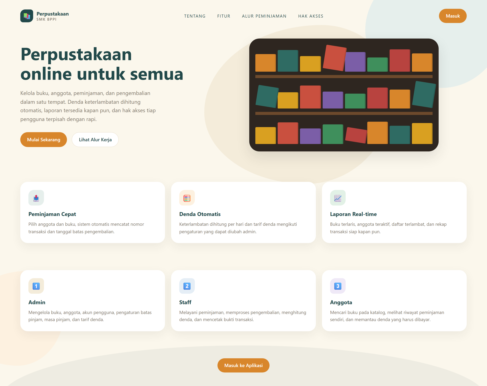

### Login

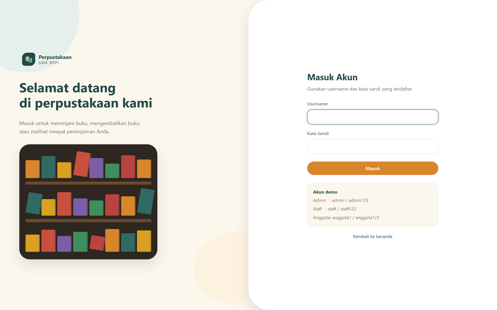

### Dashboard

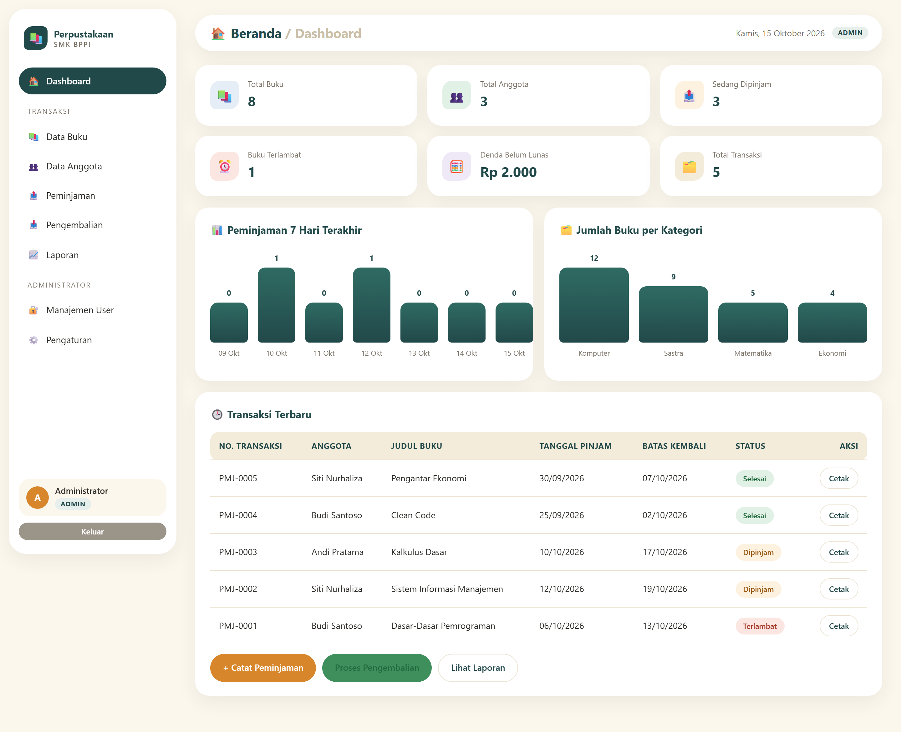

### Data Buku

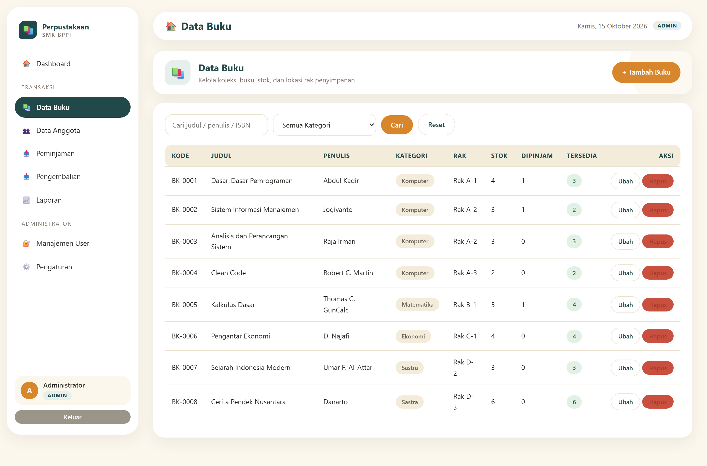

### Form Tambah Buku

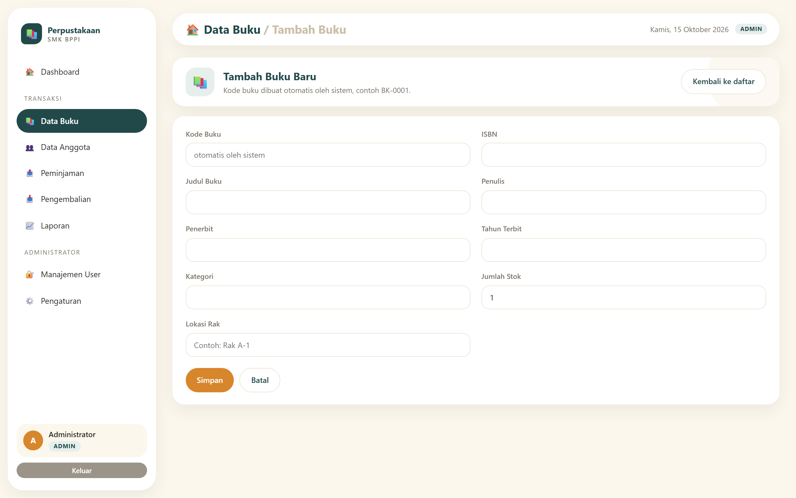

### Data Anggota

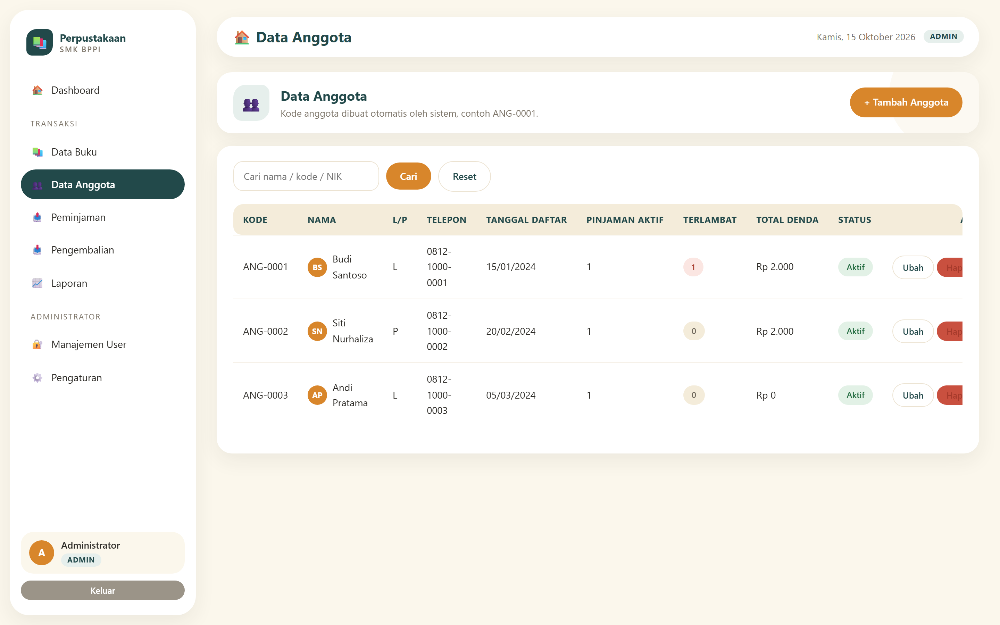

### Peminjaman

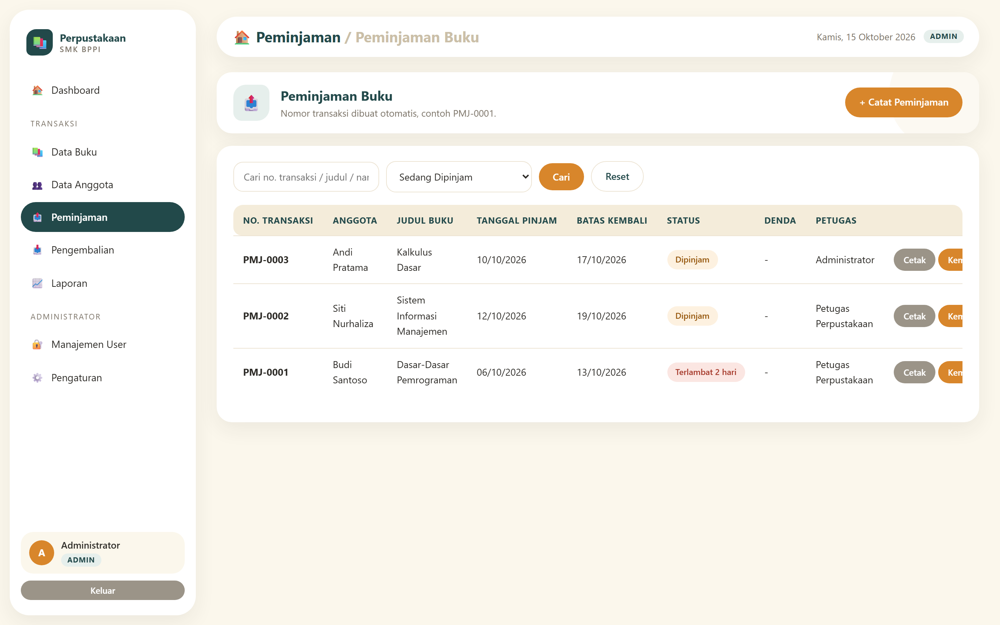

### Form Peminjaman Baru

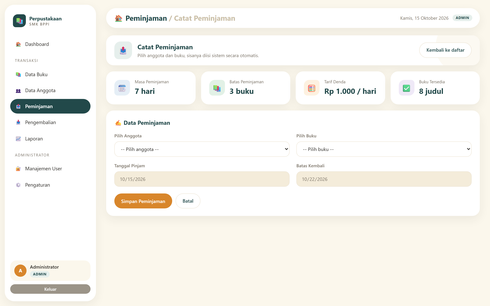

### Pengembalian

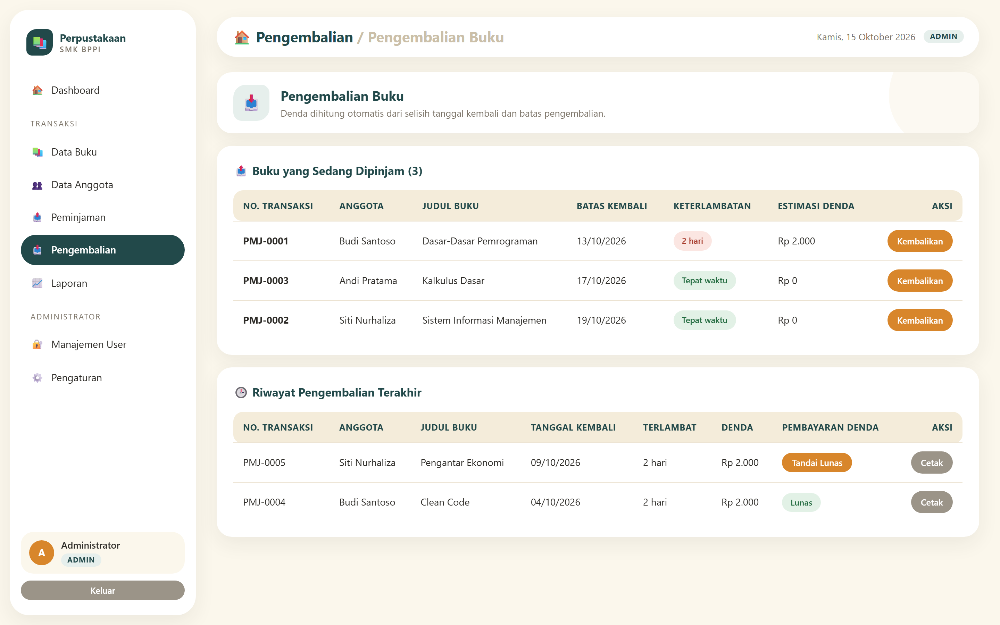

### Laporan

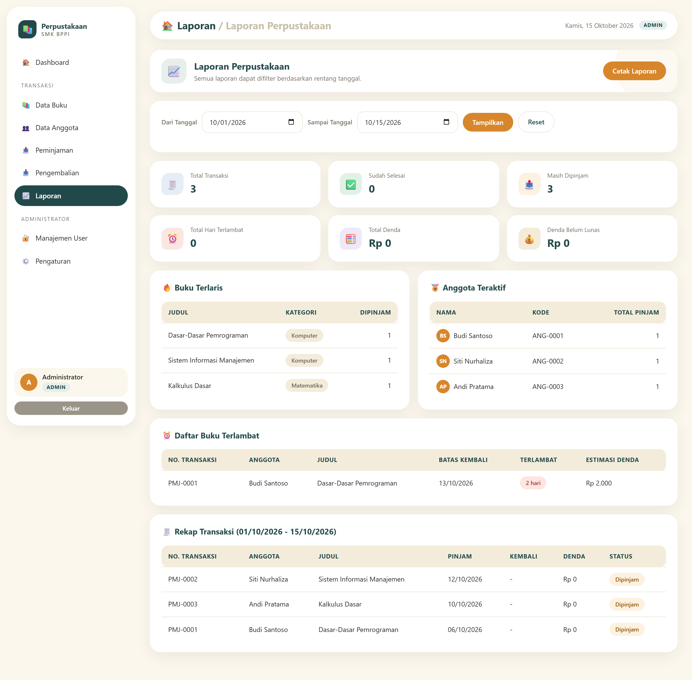

### Manajemen Pengguna

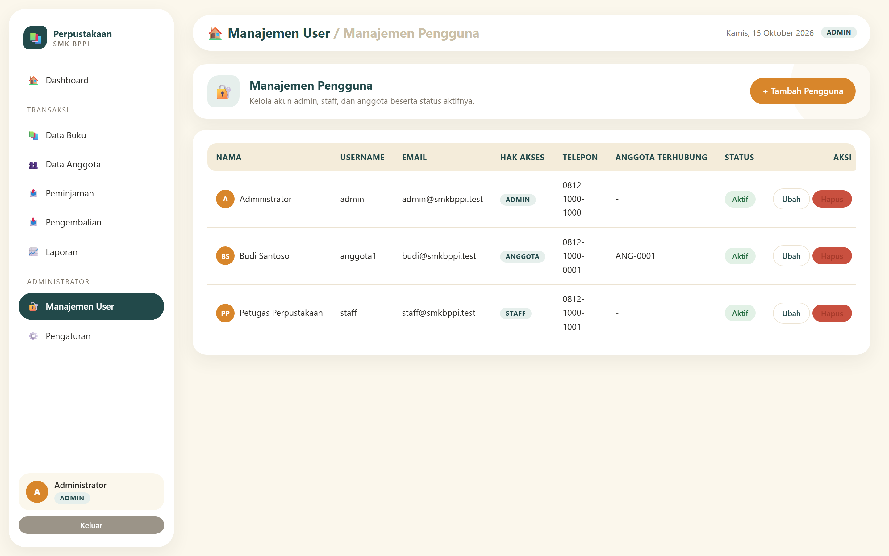

### Pengaturan

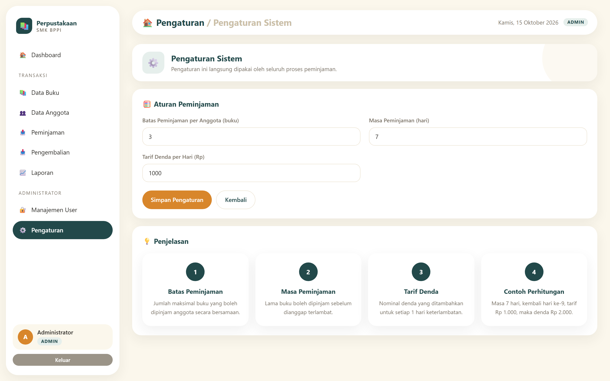

---

## Fitur

- **Autentikasi** dengan 3 level peran: admin, staff (petugas), anggota
- **Manajemen buku** — CRUD lengkap dengan kategori dan stok
- **Manajemen anggota** — CRUD lengkap dengan kode anggota otomatis
- **Peminjaman** — dengan batas peminjaman dan cetak bukti
- **Pengembalian** — hitung otomatis denda keterlambatan
- **Laporan** — rekap peminjaman, buku terlaris, dan kategori
- **Manajemen pengguna** — khusus admin
- **Pengaturan** — konfigurasi nama sekolah, alamat, dan tarif denda

## Stack

| Layer | Teknologi |
|---|---|
| Framework | Laravel 10 |
| Bahasa | PHP 8.1+ |
| Database | SQLite |
| Frontend | Blade + CSS kustom (tanpa build step) |
| Testing | PHPUnit / Laravel Test |

## Menjalankan

```bash
cd perpustakaan
composer install
cp .env.example .env
php artisan key:generate
php artisan migrate --seed
php artisan serve
```

Buka `http://localhost:8000`

Akun demo hasil seeder:

| Username | Password | Role |
|---|---|---|
| `admin` | `admin123` | Admin |
| `staff` | `staff123` | Petugas |
| `anggota1` | `anggota123` | Anggota |

## Testing

```bash
cd perpustakaan
php artisan test
```

CI otomatis jalan tiap push dan pull request ke `main`.

## Dokumentasi Lain

- [`perpustakaan/README.md`](perpustakaan/README.md) — dokumentasi lengkap aplikasi
- [`PRD-PERPUSTAKAAN.md`](PRD-PERPUSTAKAAN.md) — dokumen kebutuhan produk
- [`PRESENTASI.md`](PRESENTASI.md) — bahan presentasi
- [`TATACARA-BUKA.md`](TATACARA-BUKA.md) — prosedur operasional

## Lisensi

MIT — lihat [LICENSE](LICENSE).